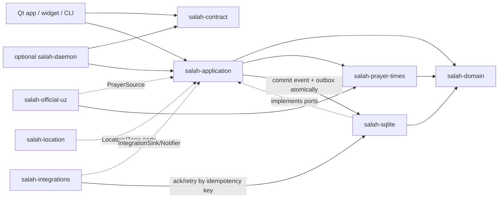

# Target architecture

## Design goals

- One authoritative planner model shared by desktop, widget, CLI, notes, Telegram, Slack, and future sync.
- Pure rules are deterministic; all clock, IDs, storage, network, filesystem, notification, and integration effects enter through ports.
- Local-first operation remains complete without a daemon or network.
- Contracts and persisted events evolve explicitly; adapters may fail without corrupting the planner transaction.

## Cargo workspace

| Crate/path | Responsibility | May depend on |
|---|---|---|
| `crates/salah-domain` | Items, entries, prayer marks, block/day identity, recurrence, value objects, domain events and invariant errors. No serde requirement on core entities unless deliberately isolated under a feature. | `chrono`-like value types only; no Salah crate |
| `crates/salah-prayer-times` | Pure astronomical calculation, prayer timeline/block-window rules, typed calculation method and source-neutral schedule models. | `salah-domain` for block/prayer IDs only |
| `crates/salah-application` | Commands/queries and projections; transaction orchestration; source selection; ports: `Clock`, `IdGenerator`, `UnitOfWork`/repositories, `PrayerSource`, `ConfigRepository`, `EventLog`/`Outbox`, `Notifier`, `IntegrationSink`. | domain, prayer-times |
| `crates/salah-contract` | Versioned transport DTOs, stable error codes/envelope, JSON serialization, compatibility fixtures/schema. No business decisions. | domain/application DTO mapping only |
| `crates/salah-sqlite` | SQLite records, migrations, repository/unit-of-work, event log and transactional outbox; concurrency/retry mapping. | application ports, domain |
| `crates/salah-official-uz` | Muslim Board HTTP client, parser, cache, coverage/location IDs; implements `PrayerSource`. | application ports, prayer-times |
| `crates/salah-location` | Omarchy Weather/IP location adapters and IANA-zone resolution; no config mutation policy. | application ports/domain value types |
| `crates/salah-integrations` | Generic outbox dispatcher, idempotency bookkeeping, retry/backoff; optional Telegram/Slack/notes adapters behind `IntegrationSink`/`Notifier`. | application ports, contract as needed |
| `crates/salah-cli` | Clap, human output, JSON v1 compatibility, client of in-process application now and daemon later. | application, contract, local adapters |
| `crates/salah-daemon` (later) | Per-user single writer, versioned Unix-socket API, subscriptions/push, outbox worker, graceful lifecycle. | application, contract, adapters |
| `app/` | Qt client; transport client and presentation only. | CLI JSON now; socket SDK later |
| `plugin/local.salah/` | Compact presentation; no recurrence/schedule rules. | CLI JSON now; socket/subscription later |

Allowed direction is inward: adapters/transport → application → domain and prayer-times. `salah-contract` describes the boundary but never calls adapters. Domain never depends on application, transport, serde JSON, SQLite, config files, clocks, or networks.



## Current module mapping

Every current Rust source file has one destination; non-Rust clients remain adapters.

| Current file | Target |
|---|---|
| `src/calculation.rs` | `salah-prayer-times::calculation` |
| `src/day.rs` | Split: prayer/day timeline rules → `salah-prayer-times::timeline`; stable `PrayerId`, `BlockId`, `PlanningDay` → `salah-domain::time` |
| `src/item.rs` | `salah-domain::{item,entry,recurrence}`; move `BlockKey` into domain |
| `src/quick.rs` | Pure grammar → `salah-application::quick_add`; return a neutral `NewItemDraft`, not planner internals |
| `src/schedule.rs` | Pure windows → prayer-times; source-selection orchestration → `salah-application::schedule`; cache access removed to port |
| `src/planner.rs` | Split into `application::items`, `timers`, `prayers`, `day_plan`, `history`, `stats`; depend on repository ports |
| `src/status.rs` | Projection assembly → `application::status`; wire shapes/formatting → `salah-contract::v1` |
| `src/store.rs` | `salah-sqlite::{migrations,records,repositories,unit_of_work}` |
| `src/export.rs` | Export/import use case → application; versioned file DTO/validation → contract; persistence mapping → SQLite adapter |
| `src/config.rs` | Validated settings types → domain/application; XDG JSON repository → CLI/local adapter |
| `src/official.rs` | Parser/client/cache → `salah-official-uz`; parsing receives fetch time |
| `src/location.rs` | `salah-location::{omarchy_weather,http,zone}`; throttling/save policy → application |
| `src/main.rs` | `salah-cli::{args,handlers,human,json_v1}` |
| `src/lib.rs` | Removed after workspace facade transition; temporary compatibility facade may re-export old API |
| `app/src/*`, `app/tests/*` | Qt transport/view adapter and consumer contract tests; no recurrence/timer arithmetic |
| `plugin/local.salah/*` | Widget transport/view adapter; generated/fixture-tested v1 decoding |
| `tests/cli.rs`, `tests/planner_cli.rs` | CLI compatibility tests in `salah-cli/tests` |
| `tests/export.rs` | Contract/application import-export tests |
| `tests/config.rs` | Local config adapter tests |

## Ports and transaction model

Use narrow capabilities, not a universal service locator:

```rust
trait Clock { fn now(&self) -> Instant; }
trait PrayerSource { fn schedule(&self, request: PrayerRequest) -> Result<Option<SourcedSchedule>, PrayerSourceError>; }
trait UnitOfWork {
    fn transact<T>(&mut self, f: impl FnOnce(&mut dyn PlannerRepository, &mut dyn EventWriter) -> AppResult<T>) -> AppResult<T>;
}
trait Outbox { fn claim(&mut self, limit: usize) -> AppResult<Vec<OutboxMessage>>; fn acknowledge(&mut self, id: EventId) -> AppResult<()>; }
```

Each successful mutation increments an aggregate revision and writes its domain event plus outbox rows in the same SQLite transaction. Dispatch happens after commit. Consumers store event/idempotency IDs; retries are at-least-once and safe. Do not make Slack/Telegram calls inside the planner transaction.

## Error model

- Domain: closed enums such as `ValidationError`, `InvariantError`, `Conflict { expected, actual }`.
- Application: `AppError::{Validation, NotFound, Conflict, Busy, SourceUnavailable, Permission, Internal}` with source chains; no user prose in lower layers.
- Adapters preserve causes and classify SQLite busy/constraint, HTTP timeout/rate-limit, parse, and filesystem failures.
- Contract envelope: `{"api_version":"1.0","request_id":"…","data":…}` or `{"api_version":"1.0","request_id":"…","error":{"code":"conflict","message":"…","retryable":false,"details":{…}}}`. Codes and fields are stable; CLI exit codes map by class.
- Logs may include diagnostic chains; JSON/stderr must not leak secrets, SQL, tokens, or provider bodies.

## Time and zone model

- Persist event instants as UTC plus millisecond precision; inject `Clock` everywhere.
- Persist user zone as an IANA ID such as `Asia/Tashkent`, not an offset. Resolve offset for the relevant instant/date.
- Model `PlanningDay` separately from civil date because sleep→Fajr belongs to the coming planning day.
- Prayer calculations receive local civil date, coordinates, and resolved offset; projections retain zone/provenance.
- For user-entered local times, reject or explicitly resolve nonexistent DST times; choose and document the earlier/later offset for ambiguous times. Recompute future schedules after tzdata/zone/config changes; never rewrite historical UTC events.
- Migration: infer the best zone from coordinates, require confirmation if ambiguous, retain legacy fixed offset as a temporary fallback and emit a warning.

## API and compatibility

### Now

- Preserve existing CLI commands and unwrapped v1 JSON during extraction.
- Add `salah api --version 1 <operation>` (or an equivalent hidden compatibility mode) with the envelope, stable errors, and `capabilities`/version negotiation.
- Put DTOs in `salah-contract`; snapshot canonical fixtures for status, day, stats, mutations, config, and errors. App/widget tests decode those fixtures; Rust tests ensure producers match them.
- Additive optional fields are allowed within major v1. Removing/renaming fields, changing meaning/type, or enum values requires v2. Consumers reject unsupported majors and tolerate unknown fields/minors.

### Later

- The daemon exposes the same operations over a user-only Unix socket (`$XDG_RUNTIME_DIR/salah.sock`) with peer permissions, request IDs, optimistic `expected_revision`, and subscriptions (`planner.changed`, `timer.changed`, `outbox.state`).
- CLI auto-connects to the daemon and may fall back to in-process mode for read-only/offline recovery. Once the daemon is the writer, mutation fallback must not create a second writer.
- App/widget use a small client library or socket bridge, not shell strings. Telegram/Slack/notes consume committed events through integration adapters, never the UI DTO.

## Migration plan

Each numbered step is one reviewable commit and must finish with `./scripts/test`, `cargo clippy --offline --all-targets -- -D warnings`, and `git diff --check` green. Characterization tests precede movement; behavior stays compatible unless a step explicitly versions it.

| Step | Commit-sized change | Parallelism |
|---:|---|---|
| 1 | Add golden JSON/error fixtures for every app/widget command and consumer compatibility tests; document v1 evolution rules. No production behavior change. | Can run alongside step 2 if one owner touches tests/contract docs only. |
| 2 | Introduce typed `AppError`/stable error codes behind existing CLI strings; first classify validation, not-found, conflict/busy, source unavailable. | Parallel with step 1; avoid `main.rs` overlap by owning only library modules initially. |
| 3 | Split `planner.rs` internally into item/timer/day/stats modules with identical public facade and tests. | Serial after step 2; one owner because imports/facade overlap. |
| 4 | Add `Clock` and `IdGenerator`; thread them through application functions while keeping convenience wrappers for CLI. Remove `Utc::now` from parsing. | Can parallelize official parser clock removal and planner ID/clock work in disjoint files. |
| 5 | Define repository/unit-of-work traits and adapt the existing SQLite `Store`; make position/move/timer invariants atomic and classify busy errors. | Serial, high-risk persistence seam. |
| 6 | Create workspace and extract `salah-domain` (`item`, entry, recurrence, block identity) with a compatibility re-export. | Serial after 3/5; mostly mechanical but dependency-sensitive. |
| 7 | Extract `salah-prayer-times`; move formatting out; replace schedule’s cache read with an injected `PrayerSource`. | Can parallelize with step 8 after domain types settle. |
| 8 | Extract `salah-contract`; map application projections to explicit v1 DTOs and add the versioned envelope/API command while retaining legacy output. | Parallel with 7; owns contract/CLI mapping, not prayer modules. |
| 9 | Move SQLite/config/official/location effects into adapter crates; add fake adapters and failure-path tests. | Separate owners can extract SQLite, official, and location/config if Cargo workspace edits are serialized by an integrator. |
| 10 | Add IANA zone setting and coordinate-based resolution with legacy offset fallback/migration; add DST transition tests. | Serial after prayer/application ports. |
| 11 | Add domain event table, aggregate revisions, transactional outbox, idempotency tests, and export support. No external integration yet. | Serial with SQLite owner; contract fixtures can update in parallel after schema lands. |
| 12 | Build one proof adapter (prefer notes/local webhook before Slack/Telegram auth) that consumes the outbox and demonstrates retry/idempotency. | Independent of UI once step 11 is stable. |
| 13 | Add optional daemon/socket with the existing versioned contract; CLI remains compatibility client. Load/concurrency-test one writer plus subscribers. | Serial integration step. |
| 14 | Move app/widget from process spawning/polling to the daemon; delete duplicated recurrence/timer logic only after parity tests. | App and widget can run in parallel in disjoint trees. |

Recommended first three steps are 1–3: lock the current contract, introduce errors that ports can use, then split the god module without changing behavior.

## Do not do yet

- **Do not create microservices or a remote server.** A local planner gains operational failure modes without a proven multi-user requirement; ports and events provide the seam.
- **Do not build the daemon first.** It would fossilize today’s unversioned DTOs and god use cases behind a socket.
- **Do not make a generic plugin framework.** Implement one integration port and one real adapter; generalize only repeated needs.
- **Do not adopt event sourcing as the sole database.** An outbox/event log supports sync and integrations while SQLite tables remain simple query models.
- **Do not split into one crate per file/entity.** Crates enforce meaningful volatility/security boundaries; too many create feature/version friction.
- **Do not rewrite Qt/QML or prayer math.** Preserve working clients/calculation through compatibility fixtures and incremental extraction.
- **Do not promise conflict-free sync from timestamps.** Define revisions, actor/device identity, tombstone retention, and per-aggregate conflict behavior first.
- **Do not add Kafka, a message broker, or Kubernetes.** A transactional SQLite outbox and one local dispatcher fit the current deployment and can be replaced behind ports later.
